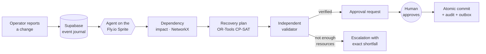
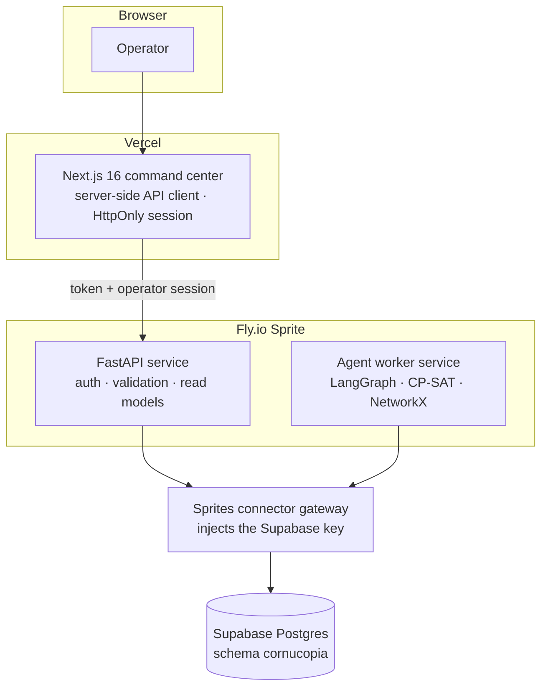

<div align="center">

# 🌽 CORNUCOPIA

### When resources change, the feast goes on.

**An autonomous resource compiler.** A persistent agent on a [Fly.io Sprite](https://fly.io/sprites) turns donations, inventory, kitchen capacity, dietary rules and delivery routes into an executable plan, and recompiles that plan when reality changes. A human approves every consequential change.

[**Live demo**](https://cornucopia-delta.vercel.app) · [Demo script](DEMO_SCRIPT.md) · [Architecture](ARCHITECTURE.md) · [Agent workflow](AGENT_WORKFLOW.md) · [Optimizer](OPTIMIZATION_ENGINE.md)

Built for **Fly.io Hacksgiving 2026**

</div>

---

## The problem

A Thanksgiving food-rescue operation has promised **500 meals** to a shelter, a senior center and a family pantry. At 2 p.m. the rice donation is cancelled.

Which meals are still possible? Can another ingredient stand in for the rice without breaking the senior center's dairy-free requirement? Is there enough kitchen time and room on the delivery routes? And who signs off before anything changes?

CORNUCOPIA answers those questions in seconds, proves its answer, and waits for a human.

## What it does: reality recompilation



1. **Journal.** An operator reports a fact, such as "rice donation cancelled". It is recorded idempotently, and its effect on inventory is applied in the same transaction.
2. **Understand.** The agent traces what depends on the changed resource (donation → lot → ingredient → recipe → batch → meal → commitment → route).
3. **Recompile.** A CP-SAT model searches for the best recovery. It may use substitutions, reroute meals and rebalance kitchen load, but it never breaks a diet, over-draws stock or exceeds capacity.
4. **Prove.** A separate validator recomputes every quantity. A plan is labelled feasible only if the validator agrees.
5. **Ask.** The proposal is bound to its fingerprint and to the exact operational state it was computed against. The agent then pauses.
6. **Commit.** After explicit approval, the database re-checks everything and commits the plan atomically, with a full audit trail. If reality changed in the meantime, the approval is refused as stale.

When resources are genuinely insufficient, it says so and escalates, for example: *"missing Potatoes 120.0 lb after every valid substitution"*. It never invents a plan.

## Try it

**Live:** https://cornucopia-delta.vercel.app

> **Judges:** sign-in details are provided with the submission. The `judge` account can run the whole scenario, including approvals. `judge-viewer` is read-only, so you can see an unauthorized approval being refused.

Follow [`DEMO_SCRIPT.md`](DEMO_SCRIPT.md) (≈ 5 min). The short version:

1. **Events** → *Donation cancelled* → pick *Rice donation* → submit.
2. **Agent / Recompilation**: watch the agent run on the Sprite and see the affected dependency graph.
3. **Approvals**: review the plan (500 of 500 meals, quinoa replacing rice), tick the confirmation, approve. The agent commits it.
4. **Events** → *Ingredient expired* → *Potatoes*: the agent escalates with the exact shortfall.
5. **Simulation**: what-if scenarios on a copy of the state; production stays untouched.
6. **Reset demo** (sidebar): start over with fresh sample data.

## Why it runs on a Fly.io Sprite

The agent is a long-lived, stateful process that has to survive restarts. A Sprite provides a persistent Linux VM, services that come back after a crash or a cold boot, and the Supabase connector. The connector means the database key never lives on the machine.

| Concern | How CORNUCOPIA handles it |
|---|---|
| Runtime | API and agent run as two Sprite services (`sprite-env services`); the agent works independently of the web UI |
| Persistence | Supabase through the **official Sprites Supabase Database connector**: REST and RPC only, credentials injected by the Fly gateway |
| Durability | A custom LangGraph checkpointer over the connector. The agent checkpoints after every step. |
| Crash recovery | Lease-based work claiming with fencing tokens. Kill the worker mid-run and another resumes from the last checkpoint without duplicating effects. |
| Staying awake | The Sprites Tasks API holds the Sprite active only while an execution runs |

## Architecture



- **No paid LLM.** Every decision is deterministic code: Pydantic schemas, NetworkX, OR-Tools CP-SAT, and LangGraph for orchestration.
- **All writes are database functions.** Multi-row changes (event ingest, approvals, plan commits) are single PL/pgSQL transactions. Direct table writes are revoked.
- **Append-only history.** The event journal, audit log, approval decisions, checkpoints and optimization runs cannot be updated or deleted.

## Tech stack

| Layer | Technology |
|---|---|
| Agent runtime | Fly.io Sprite, LangGraph, custom Supabase checkpointer |
| Optimization | Google OR-Tools CP-SAT (six-stage lexicographic objectives), NetworkX |
| API | Python 3.13, FastAPI, Pydantic v2, httpx |
| Data | Supabase Postgres via the Sprites connector; SQLAlchemy + Alembic generate migrations, the Supabase CLI applies them |
| Frontend | Next.js 16, React 19, TypeScript (strict), Tailwind CSS 4, React Flow, Recharts |
| Testing | pytest, Playwright, ruff, mypy (strict) |

## Repository layout

```
backend/            FastAPI service and the agent
  cornucopia/
    agent/          LangGraph graph, tools, checkpointer, supervisor
    compiler/       deterministic planner, calculators, validator
    optimizer/      CP-SAT model, diagnosis, candidate comparison
    depgraph/       NetworkX dependency graph and impact analysis
    simulation/     isolated what-if scenarios
    api/            HTTP routes
    persistence/    connector client, repositories, models
frontend/           Next.js command center
supabase/migrations generated SQL migrations (applied with the Supabase CLI)
db/                 Alembic config and hand-written SQL (RPCs, triggers, privileges)
scripts/            deploy, reset, seed, scenarios, migration tooling
```

## Running it yourself

You need a Fly.io Sprite, a Supabase project with the Sprites Supabase connector configured, the `sprite`, `supabase` and `uv` CLIs, and Node 20+.

```bash
supabase link --project-ref <your-project-ref> && supabase db push --remote && supabase config push
```

```bash
SUPABASE_GATEWAY_URL=https://api.sprites.dev/v1/gateway/supabase/<connection-id> scripts/deploy_sprite.sh
```

```bash
sprite exec -s cornucopia -- bash -c 'cd /home/sprite/cornucopia/current/backend && .venv/bin/python -m cornucopia.admin create-operator --username admin --name Admin --role admin --generate-password'
```

Then deploy `frontend/` to Vercel with `CORNUCOPIA_API_URL` and `CORNUCOPIA_API_TOKEN`. The full guide, including connector setup, is in [`DEPLOYMENT.md`](DEPLOYMENT.md) and [`CONNECTOR_SETUP.md`](CONNECTOR_SETUP.md).

**Resetting the demo** is manual, never automatic. An approver or admin can click **Reset demo** at the bottom of the sidebar. It takes about 40 seconds. The deployment moves to a fresh demonstration organization, every operator account is copied over with its password unchanged, and the sample data is reloaded. Everyone then signs in again. Nothing is deleted, so earlier runs keep their history. The feature is on only when `CORNUCOPIA_DEMO_RESET_ROLE` is set. `scripts/reset_demo.sh` does the same from a terminal and also redeploys.

## Testing

```bash
cd backend && uv run pytest
```

```bash
cd frontend && npx playwright test
```

- **Backend:** 111 tests. They cover unit conversions, the planner and validator, CP-SAT determinism, the agent's crash-and-resume, and Postgres-level approval races (stale, duplicate, unauthorized, expired and concurrent approvals).
- **End-to-end:** 36 Playwright tests (desktop + mobile) against the live Sprite, including the full approve → commit loop.

See [`TESTING.md`](TESTING.md).

## Security

- The Supabase secret key exists only in the Fly connector. The Sprite never holds it.
- The API requires a service token plus a signed operator session. Roles are viewer < operator < approver < admin.
- Sessions live in HttpOnly cookies. Page JavaScript never sees a credential.
- Approvals are bound to plan fingerprint and state version, need explicit confirmation, and are re-verified inside the commit transaction. Refused attempts are recorded.

See [`SECURITY.md`](SECURITY.md).

## Documentation

| Document | Contents |
|---|---|
| [ARCHITECTURE.md](ARCHITECTURE.md) | runtime topology, persistence model, security model |
| [AGENT_WORKFLOW.md](AGENT_WORKFLOW.md) | the 17-node graph, durability, recovery after restarts |
| [OPTIMIZATION_ENGINE.md](OPTIMIZATION_ENGINE.md) | compiler, CP-SAT model, objectives, diagnosis, determinism |
| [DATABASE_SCHEMA.md](DATABASE_SCHEMA.md) | tables, constraints, RPC functions |
| [DEPLOYMENT.md](DEPLOYMENT.md) / [CONNECTOR_SETUP.md](CONNECTOR_SETUP.md) | step-by-step deployment |
| [DEMO_SCRIPT.md](DEMO_SCRIPT.md) | the 5-minute walkthrough |
| [TESTING.md](TESTING.md) / [SECURITY.md](SECURITY.md) | verification and threat model |
| [JOURNAL.md](JOURNAL.md) / [CHANGELOG.md](CHANGELOG.md) | how it was built, phase by phase |
